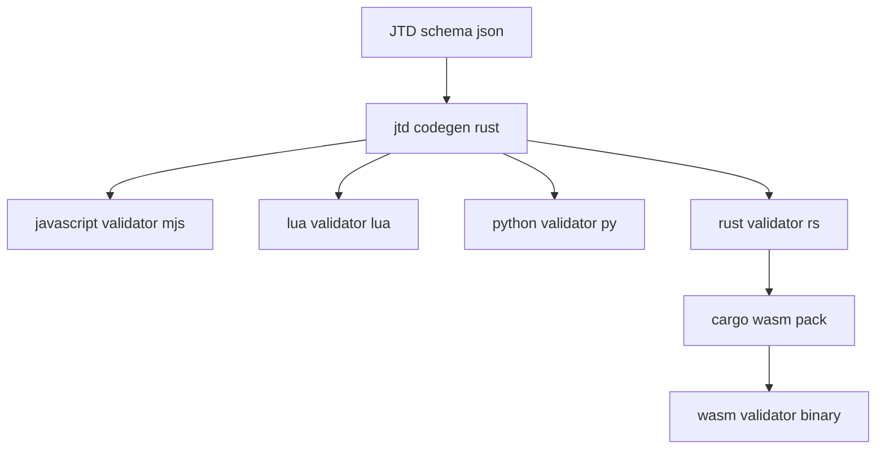

# jtd-wasm

[](https://github.com/prompt-cult/json-type-definition-RFC-8927/actions/workflows/ci.yml)
[](https://www.codefactor.io/repository/github/simbo1905/jtd-wasm)
[](https://github.com/simbo1905/jtd-wasm/releases)
[](LICENSE)

**Ahead-of-time code generator for [RFC 8927 JSON Type Definition](https://www.rfc-editor.org/rfc/rfc8927).**

Compiles JTD schemas into optimized validation functions for Rust, JavaScript, Python, and Lua. No interpreter, no AST at runtime, zero overhead.

## 🚀 Interactive Demo

**[Try the Live Playground](https://simbo1905.github.io/jtd-wasm/)**

Test schemas against the generated validators (JS and WASM) directly in your browser.



## ✨ Features

- **Zero Runtime Overhead**: Generates efficient code that performs validation directly. No schema parsing or interpretation at runtime.
- **Multi-Target**:
  - **JavaScript**: Generates standalone ESM `.mjs` files. No dependencies.
  - **Lua**: Generates portable Lua 5.1 / LuaJIT code.
  - **Python**: Generates Python 3.13+ modules using only the standard library.
  - **Rust**: Generates struct-free, dependency-light code (only `serde_json`).
  - **WebAssembly**: Combine Rust output with `wasm-pack` for native-speed browser validation.
- **Standard Compliant**: Verified against the [official JSON Type Definition compliance suite](https://github.com/jsontypedef/json-typedef-spec) (316 tests).
- **Safe & Secure**: Generated code uses finite recursion depth and explicit checks.

## 📦 Installation

### Pre-built Binaries
Download the latest release for macOS, Linux, or Windows from [GitHub Releases](https://github.com/simbo1905/jtd-wasm/releases).

### From Source
```bash
cargo install --git https://github.com/simbo1905/jtd-wasm jtd-codegen
```

## 🛠️ Usage

### CLI
Generate a validator from a schema file:

```bash
# Generate JavaScript
jtd-codegen --target js schema.json > validator.js

# Generate Lua
jtd-codegen --target lua schema.json > validator.lua

# Generate Python
jtd-codegen --target python schema.json > validator.py

# Generate Rust
jtd-codegen --target rust schema.json > validator.rs
```

### Supported Workflows

| Scenario | Workflow | Use Case |
|----------|----------|----------|
| **Rust → Rust** | Schema → `.rs` | Rust backend services needing high-performance validation. |
| **Rust → WASM** | Schema → `.rs` → `.wasm` | Browser apps needing native speed & type safety. |
| **Rust → JavaScript** | Schema → `.mjs` | Node.js/Browser apps where a standalone, readable JS module is preferred. |
| **Rust → Lua** | Schema → `.lua` | Embedded systems (Nginx, Redis, Games) using Lua 5.1 or LuaJIT. |
| **Rust → Python** | Schema → `.py` | Python services and scripts needing JTD validation with zero dependencies. |

### Code Examples

**JavaScript (ES Modules)**
```javascript
import { validate } from './validator.js';

const data = JSON.parse('{"name": "Alice", "age": 30}');
const errors = validate(data);

if (errors.length > 0) {
  console.error('Validation failed:', errors);
}
```

**Rust**
```rust
use serde_json::Value;
// Include the generated code
include!("validator.rs");

fn main() {
    let data: Value = serde_json::from_str(r#"{"name": "Alice"}"#).unwrap();
    let errors = validate(&data);
    
    if !errors.is_empty() {
        println!("Validation failed: {:?}", errors);
    }
}
```

**Lua (5.1 / LuaJIT)**
```lua
local validate = require("validator").validate

-- Assuming you have a JSON decoder (e.g., dkjson, cjson)
local data = { name = "Alice", age = 30 }
local errors = validate(data)

if #errors > 0 then
  for _, err in ipairs(errors) do
    print("Error at " .. err[1] .. ": " .. err[2])
  end
end
```

**Python (3.13+)**
```python
import json
from validator import validate

data = json.loads('{"name": "Alice", "age": 30}')
errors = validate(data)

if errors:
    for err in errors:
        print(f"Error at {err['instancePath']}: {err['schemaPath']}")
```

### Self-Documenting Schemas (`metadata`)

JTD schemas are plain JSON, which has no comments — but RFC 8927 [section 2.3](https://www.rfc-editor.org/rfc/rfc8927#section-2.3) reserves an optional `metadata` keyword for exactly this purpose. Its value is an arbitrary JSON object, it is allowed on every schema form, and it **must not affect validation or the generated code**.

You are encouraged to use `metadata` (with members like `description`, `purpose`, or `owner`) to self-document your schemas:

```json
{
  "metadata": {
    "description": "A user record for the identity service",
    "owner": "identity-team"
  },
  "properties": {
    "name": {
      "type": "string",
      "metadata": { "description": "Display name, shown in the UI" }
    }
  },
  "additionalProperties": false
}
```

Validators generated by this tool ignore `metadata` completely: schemas with and without identical metadata members compile to byte-identical generated code. Note that unlike `metadata`, unknown top-level *keywords* (such as a JSON-style `"$comment"`) are not valid JTD — use `metadata` for annotations, per RFC 8927 §2.3.

## 🧩 Skills for coding agents

Ready-made integration guides live in [`skills/`](./skills). Each one covers prerequisites, the generated validator API, single- and multi-schema codegen, Makefile wiring, and local verification against this repository's fixture schemas.

| Skill | Target | Runtime dependencies | Also emits |
|-------|--------|---------------------|------------|
| [`skills/skill-rs.md`](./skills/skill-rs.md) | Rust | `serde_json` (plus `regex`/`chrono` for `timestamp`) | `build.rs` / `wasm-pack` recipes |
| [`skills/skill-mjs.md`](./skills/skill-mjs.md) | JavaScript ESM | none | barrel `validators.mjs` |
| [`skills/skill-py.md`](./skills/skill-py.md) | Python 3.9+ | standard library only | `__init__.py` barrel |
| [`skills/skill-lua.md`](./skills/skill-lua.md) | Lua 5.1 / LuaJIT | none — vendored `skills/lua/jtd_json.lua`, no luarocks | `.d.tl` Teal declaration per validator |

The Lua skill ships a codegen driver (`skills/lua/codegen_validators.lua`) that turns `jtd-codegen --target lua` output into a module with a byte-oriented `validate(json_text) -> true | false, err` API, keeps the emitter's error-list API as `validate_instance(value)`, and writes a `.d.tl` beside every module so Teal call sites type-check under `tl check`:

```bash
luajit skills/lua/codegen_validators.lua --out generated --barrel validators schemas/*.jtd.json
luajit skills/lua/test_validators.lua generated
cd generated && tl check validators.d.tl
```

## 🧪 Development & Testing

This project uses `xmake` to orchestrate tests and cross-language verification.

```bash
# Run full verification (Format + Clippy + Rust/JS/WASM Tests)
xmake run test_all

# Run code quality checks only
xmake run check

# Install git pre-commit hook
xmake run install_hooks
```

## 📄 Specification

The code generator implements [JTD_CODEGEN_SPEC.md](./JTD_CODEGEN_SPEC.md). This repository includes a corrected copy of the upstream spec, validated against the official test suite.

## ⚖️ License

MIT License - see [LICENSE](LICENSE) for details.
